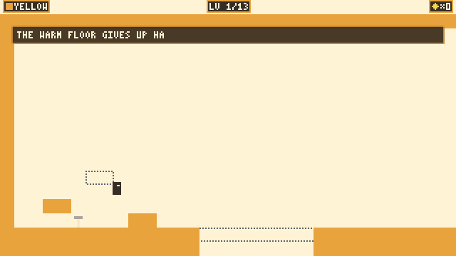
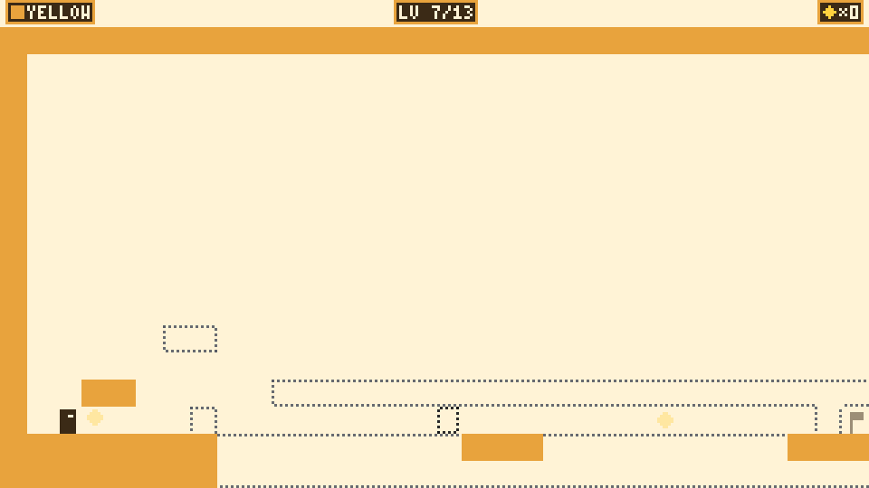
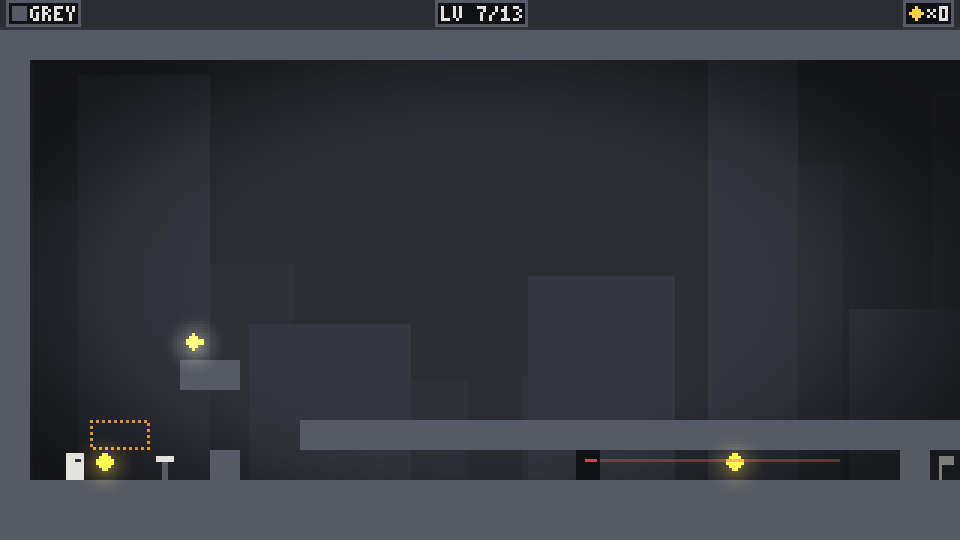

# Two Realities



A puzzle-platformer about living in two overlapping worlds, made for **GitHub Game Off 2026** (theme: **SHIFT**).

**Play in the browser:** https://carvalhocaio.itch.io/two-realities

The **yellow** world is warm and open. The **grey** world is cold, and it is watching. Only the active world is solid; the other stays on screen as a dotted ghost. Shifting into grey is free, but coming back costs a yellow fragment, and fragments only exist in grey. Later the shift locks to the beat of the music, then swaps on its own, up to a three-phase fight with the Warden.

- 13 handmade levels in three acts, one new idea per level
- Rhythm-locked shifting with music synthesized in code
- 12 secrets that move: each level has up to 3 hidden spots and one is drawn every time you enter it, so you have to look instead of memorizing
- Speedrun timer and personal bests, Pressure 1-5 challenge mode after the first clear
- Continue from the furthest level reached, assist mode with level skip, audio offset, English and Brazilian Portuguese
- Sound effects synthesized in code, like the music

| Yellow | Grey |
|---|---|
|  |  |

## Controls

| Key | Action |
|---|---|
| A/D or arrows | move |
| Space, W or Up | jump |
| Shift | swap worlds |
| R | restart the level |
| M / T | mute / timer |
| P, Enter or Esc | pause (assist, audio offset, language) |
| L | language (title screen) |
| H | how to play (title screen; also in the pause menu) |
| Up / Down | starting level (title screen, after reaching level 2) |

With a gamepad: left stick or d-pad to move, A to jump, B/X/LB/RB to shift, Start to pause, Back to restart, Y for how to play.

## Build and run

Requires Go (version in `.tool-versions`).

```sh
make run         # desktop
make run-dev     # desktop with ] / [ level skip
make test        # all tests (Go and the web loader, needs Node)
make test-cover  # the same with coverage
make lint        # go vet (also with -tags dev) + gofmt
make build-wasm  # web/game.wasm + wasm_exec.js
make serve       # serve web/ on :8080 (PORT= to change)
make package     # dist/html5, the folder uploaded to itch.io
make shots OUT=dir  # scripted screenshots for the itch page
```

Pushing a `v*` tag deploys the build to itch.io through GitHub Actions and butler.

## Code

Go with [Ebitengine](https://ebitengine.org/). Game logic lives in pure packages under `internal/` (level parser, physics, session, rhythm clock, music synth, save, i18n) and is tested without a window; Ebitengine is only used in `internal/ebitenapp`. Levels are plain-text files in `internal/level/levels/`. Every level has a scripted solution in the tests, every secret spot is taken by a test that then finishes the level, and known exploits (walking on watcher corridor roofs, pausing to bend the beat) have regression tests. Design notes and architecture rules are in [CLAUDE.md](CLAUDE.md).

## AI use

This game was made with an AI coding assistant (Claude Code, by Anthropic), as disclosed on the itch.io page. No AI image, audio or voice generators were used: graphics are drawn by code and the music and sound effects are synthesized by the game at startup.
